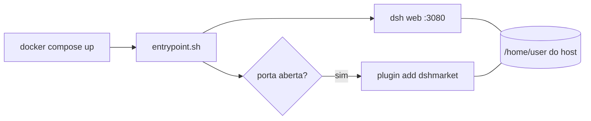

# Deepseek Hardness - Docker

**DeepSeek `dsh web` rodando em Docker, com acesso às pastas do seu sistema e plugin `dshmarket` instalado sozinho.**

Sobe a interface web do `dsh` em um container. O container usa seu `HOME` real, então enxerga seus projetos e guarda configuração e plugins no host.

## O que faz

- Executa `dsh web` isolado em container, sem abrir navegador.
- Monta `/home/user` do host: o `dsh` acessa `~/projetos` e persiste profiles e plugins.
- Instala `dshmarket` no profile `web` a cada partida, de forma automática.
- Reinicia sozinho (`unless-stopped`) e reporta saúde via healthcheck.

## Início rápido

```bash
docker compose up -d --build
docker logs dsh-web
```

Abra o link com token que aparece no log:

```
dsh web: http://127.0.0.1:3080/?token=...
```

> Depois de mudar o `Dockerfile` ou o `entrypoint.sh`, use sempre `--build`. Sem ele o compose reaproveita a imagem antiga.

## Requisitos

- Docker com Compose v2 e BuildKit (padrão nas versões atuais).
- Usuário do host com uid/gid `1000`.
- Porta `3080` livre no host.
- Acesso ao Docker (`sudo` se seu usuário não estiver no grupo `docker`).

## Uso

| Ação | Comando |
|------|---------|
| Subir / reconstruir | `docker compose up -d --build` |
| Ver log e token | `docker logs -f dsh-web` |
| Status e saúde | `docker ps` |
| Reiniciar | `docker compose restart` |
| Parar | `docker compose down` |
| Shell no container | `docker exec -it dsh-web bash` |

## Como funciona



1. O `entrypoint.sh` sobe o `dsh web` em segundo plano.
2. Espera a porta `3080` abrir, checando a cada 0,25 s (limite de 60 s).
3. Roda `dsh plugin --profile web add dshmarket`. Falha aqui não derruba o servidor.
4. Fica no `wait` e repassa `SIGTERM`/`SIGINT` ao `dsh`.

## Configuração

| Item | Valor | Onde |
|------|-------|------|
| Porta | `3080` | `entrypoint.sh` |
| Bind | `127.0.0.1` (só local) | `entrypoint.sh` |
| Rede | `host` | `docker-compose.yml` |
| Usuário | `1000:1000` | `docker-compose.yml` |
| Volume | `/home/user:/home/user` | `docker-compose.yml` |
| Diretório de trabalho | `/home/user/projetos` | `docker-compose.yml` |

## Desempenho

- **Cache de build:** `apt` e `npm` usam cache do BuildKit. Rebuilds não baixam tudo de novo.
- **Camadas:** dependências são instaladas antes do `COPY` do script. Mexer no `entrypoint.sh` não refaz o `npm i`.
- **Contexto mínimo:** o `.dockerignore` envia só o `entrypoint.sh` ao daemon.
- **Imagem enxuta:** `node:24-slim`, `--no-install-recommends`, sem `audit` nem `fund` no npm.
- **Partida rápida:** polling de 0,25 s em vez de 1 s.
- **`init: true`:** processo de init correto, com sinais tratados e sem zumbis. O `stop` é rápido.
- **Logs limitados:** 3 arquivos de 10 MB, o disco não enche.
- **Store do pnpm** fica no seu `HOME`, então é compartilhado entre partidas.

## Segurança

- O servidor escuta só em `127.0.0.1`. Não fica exposto na rede.
- O token da URL dá acesso à interface. Não compartilhe o log.
- O container lê e escreve em todo o seu `HOME`. Confie no que o `dsh` executa.
